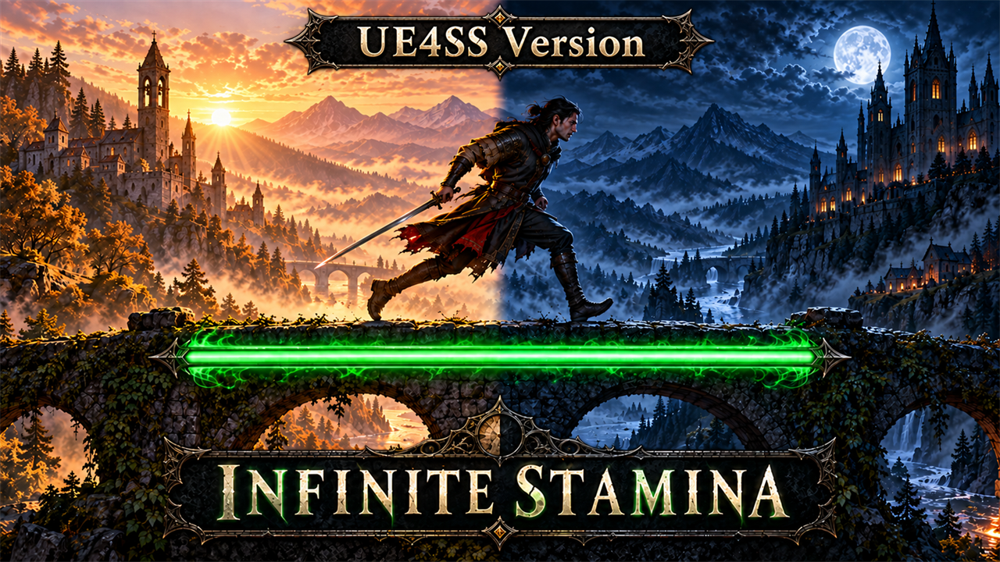

# Infinite Stamina (UE4SS)

The player never runs out of stamina, as a UE4SS script that changes no game file. Enemies keep their normal stamina.

## What it does

- Sprinting, dodging, attacking and blocking use no stamina: your stamina bar stays full.
- Only you are changed. Enemies still get tired.
- It uses the game's own switch: the gameplay tag `Effect.InfiniteStamina`, which the game itself gives you for a few
  seconds during the Shadowstorm spell. A small Lua script gives you this tag while the game runs, and checks every
  two seconds that you still have it (after loading a save, a death or a change of form).
- It replaces no game file, so it cannot conflict with mods that change game files.
- The same mod without UE4SS: [Infinite Stamina](https://github.com/KintaroModding/dawnwalker_infinitestamina). Use
  only one of the two.

## Screenshots

## How to install

1. Install UE4SS for The Blood of Dawnwalker, for example
   [UE4SS for The Blood of Dawnwalker](https://github.com/KintaroModding/dawnwalker_ue4ss): the official UE4SS build
   with the UE4SS team's config for this game.
2. Download `dawnwalker_infinitestamina_ue4ss_1.2.zip` from the latest release on GitHub.
3. Unpack it into the game folder `Dawnwalker\Binaries\Win64\`, next to `Dawnwalker.exe`. It adds the folder
   `ue4ss\Mods\dawnwalker_infinitestamina_ue4ss\` (with the file `enabled.txt`, UE4SS starts it by itself).
4. Start the game and load a save.

To check that it runs: `Dawnwalker\Binaries\Win64\ue4ss\UE4SS.log` has the line
`[Infinite Stamina (UE4SS)] 1.2 loaded.`, and after you load a save `Effect.InfiniteStamina added to ...`.

To update the mod, replace the folder with the one of the new release. To remove it, delete the folder
`ue4ss\Mods\dawnwalker_infinitestamina_ue4ss\`.

## How to use

Nothing to do: the mod works as soon as you load a game.

## Compatibility

- Game version: Patch 2 (`dw1-pc-258504-shipping-patch2-all-CL-258504`).
- Tested with UE4SS `v3.0.1-1181-g83330635` (the official `experimental-latest` build of 2026-10-17) and the
  `TheBloodOfDawnwalker` config of the UE4SS team. Other UE4SS builds for this game were not tested.
- Do not use it together with the asset version or with other infinite stamina mods.

## Known issues

- After you load a save, it can take up to two seconds until the effect starts.

## How to build

There is nothing to build: `src\dawnwalker_infinitestamina_ue4ss\Scripts\main.lua` is the mod. `tests\test_main.py`
runs the script outside the game with Lua 5.4 ([lupa](https://pypi.org/project/lupa/)) and mocks of UE4SS:
`python tests\test_main.py`. `README.md` has the details.

## Credits

Made by Kintaro. MIT license: you may use, change and share this mod. UE4SS is made by the
[UE4SS-RE team](https://github.com/UE4SS-RE/RE-UE4SS). The Blood of Dawnwalker belongs to Rebel Wolves.
